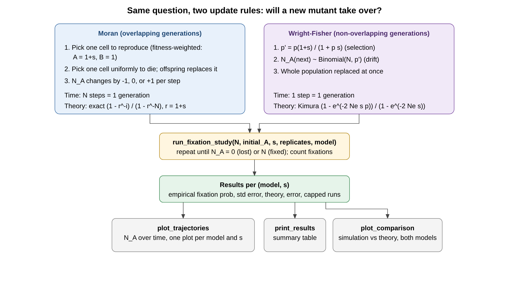

# Fixation of a Beneficial Mutation: Moran vs. Wright-Fisher



## What this project asks

A new mutation (allele **A**) appears in one cell of a haploid population of fixed size *N*. Everyone else carries the wild type (**B**). What is the probability that A takes over the whole population (fixation), and how does a selective advantage *s* change it?

I answer this by simulating two standard population-genetics models side by side and comparing each to its own theoretical prediction:

| | Moran | Wright-Fisher |
|---|---|---|
| Generations | Overlapping | Non-overlapping |
| One step | One birth and one death | The whole population is resampled |
| Selection | Reproduction chosen with weight 1+*s* for A, 1 for B | *p'* = *p*(1+*s*)/(1+*p s*) |
| Drift | Random choice of who dies | *N_A* next ~ Binomial(*N*, *p'*) |
| Time unit | *N* steps = 1 generation | 1 step = 1 generation |
| Theory | Exact: ρ = (1 − r⁻ⁱ)/(1 − r⁻ᴺ), r = 1+*s* | Kimura diffusion: (1 − e^(−2·N_e·s·p))/(1 − e^(−2·N_e·s)) |

For both models ρ = *i*/*N* when *s* = 0. In the Kimura formula, *p* = *i*/*N* is the starting frequency and *N_e* = *N*.

## What the code does

| Function | Role |
|---|---|
| `simulate_moran_process`, `simulate_wright_fisher_process` | Run one trajectory until A is lost (0) or fixed (*N*), or `max_generations` is reached. Return the outcome and the trajectory. |
| `wright_fisher_generation` | One Wright-Fisher update: selection, then binomial sampling. |
| `theoretical_fixation_probability(N, i, s, model)` | Exact Moran result, or the Kimura approximation for Wright-Fisher. |
| `run_fixation_study(N, initial_A, s, num_replicates, model)` | Repeats the simulation and returns the empirical fixation probability, standard error, theory, error, and the number of capped runs. |
| `plot_trajectories`, `plot_comparison`, `print_results` | Trajectory plots, simulation-vs-theory plot for both models, and the summary table. |

"Capped runs" are replicates that hit `max_generations` without reaching 0 or *N*. Counting them shows whether the cap biased the estimate.

## Results (N = 50, one initial mutant, 2,000 replicates per condition)

| Model | s | Fixations | Empirical ρ | Theory ρ |
|---|---|---|---|---|
| Moran | 0.00 | 38/2000 | 0.0190 | 0.0200 |
| Moran | 0.01 | 48/2000 | 0.0240 | 0.0253 |
| Moran | 0.02 | 62/2000 | 0.0310 | 0.0312 |
| Moran | 0.05 | 113/2000 | 0.0565 | 0.0522 |
| Moran | 0.10 | 189/2000 | 0.0945 | 0.0917 |
| Wright-Fisher | 0.00 | 40/2000 | 0.0200 | 0.0200 |
| Wright-Fisher | 0.01 | 54/2000 | 0.0270 | 0.0313 |
| Wright-Fisher | 0.02 | 93/2000 | 0.0465 | 0.0453 |
| Wright-Fisher | 0.05 | 214/2000 | 0.1070 | 0.0958 |
| Wright-Fisher | 0.10 | 334/2000 | 0.1670 | 0.1813 |

No runs hit the cap. These come from one run without a fixed seed, so your numbers will differ slightly. With 2,000 replicates and fixation probabilities of 2% to 18%, the standard error is roughly 0.003 to 0.009.

**Main takeaway:** at the same *s*, a beneficial mutation fixes about 1.8 times as often under Wright-Fisher as under Moran (0.17 vs. 0.09 at *s* = 0.10). The two models have different drift strength, so a theory curve has to match the model being simulated. Comparing a Moran simulation against the Wright-Fisher (Kimura) formula makes a correct simulation look wrong.

## How to run

```bash
pip install numpy matplotlib
jupyter notebook
```

Set the hyperparameters at the top of the execution cell (`N`, `initial_A`, `num_replicates`, `s_values`, `models`), then run all cells. Plots are saved as PNG files.

Author ~ Charlotte Barretto 
